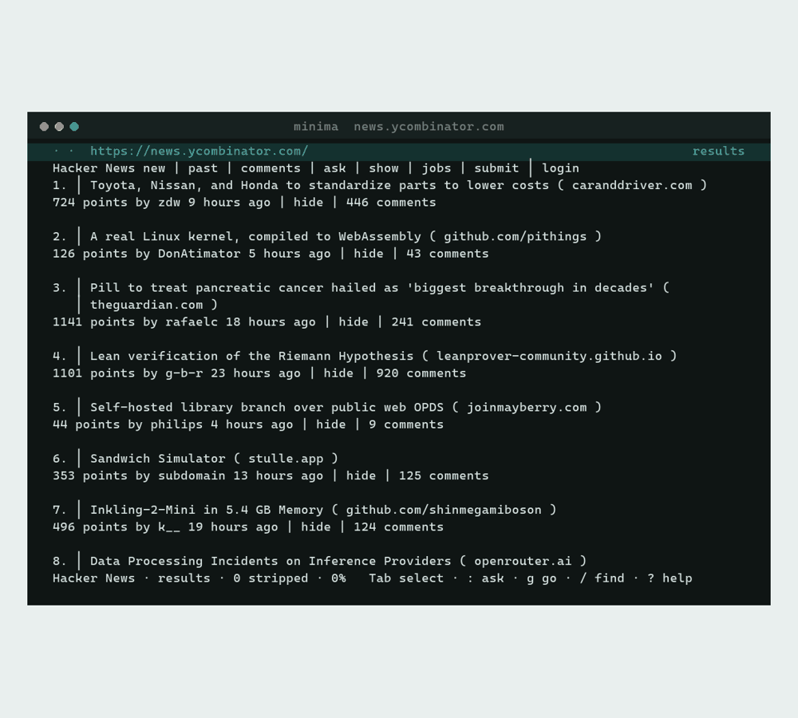
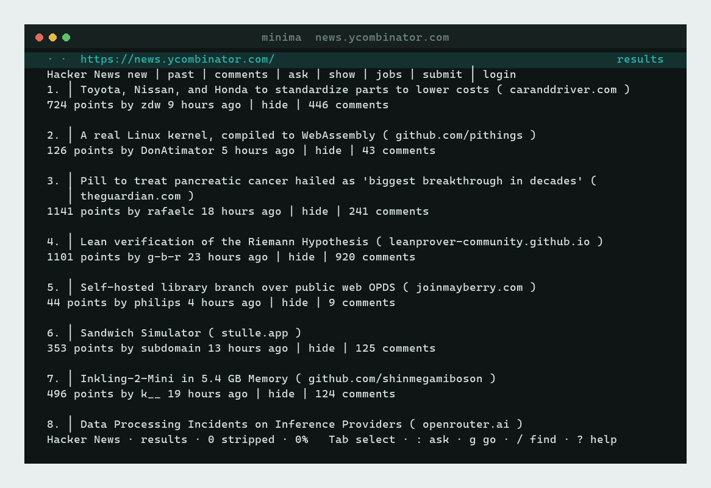
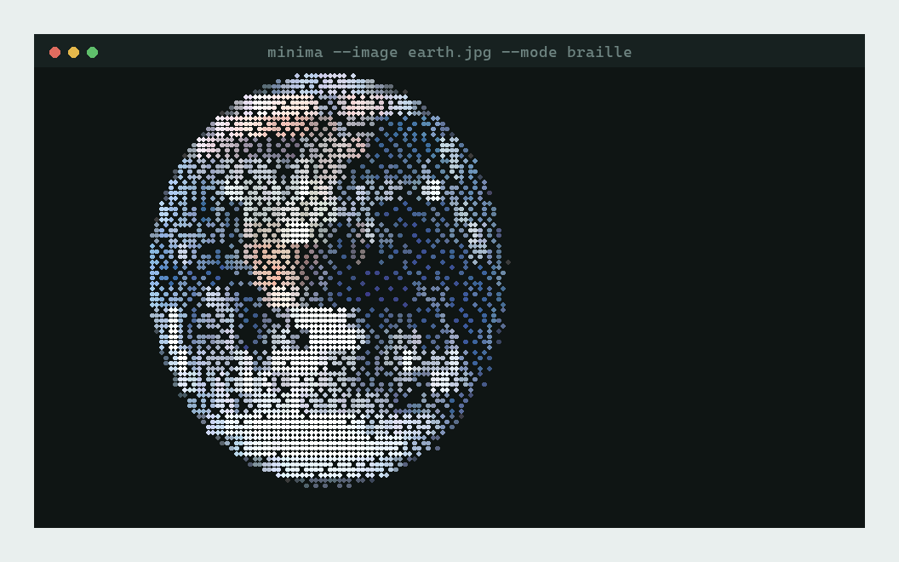

<p align="center"></p>

<h1 align="center">Minima</h1>

<p align="center">A terminal web browser that shows you the page and nothing else.<br>
One small Rust binary. No ads, no menus, no cookie banners, no JavaScript.</p>

<p align="center"></p>

## Why

I wanted to read the web on an old laptop and over SSH without waiting for a real browser.
Minima fetches a page, throws away the clutter, and gives you the text, links, buttons and
forms in your terminal. Images turn into braille or ASCII art. There is no cloud
service, no model to download, nothing to set up.

## Install

| OS | Get it |
|---|---|
| Windows | `minima-…-setup.exe` from [Releases](../../releases/latest) |
| macOS | `.pkg` or `.dmg` from Releases |
| Debian / Ubuntu | `sudo apt install ./minima_…deb` |
| Fedora | `sudo dnf install ./minima-….rpm` |
| Anything else | `.tar.gz` / `.zip` from Releases, or `cargo install --git https://github.com/SamratDuttaOfficial/minima minima` |

## Use

```
minima                       # open your home page
minima rust async book       # search
minima https://example.com   # open a URL
minima --dump URL            # print the cleaned page as text
minima --image photo.jpg     # print an image as terminal art
```

`Tab` moves between links and fields, `Enter` follows, `:` lets you type what you want
(`click sign in`, `search for rust`), `?` shows every key.

<p align="center">


</p>

## What it can't do

No JavaScript, so pages that only render in the browser come up mostly empty. Video needs
`ffmpeg`. Details in [docs/USAGE.md](docs/USAGE.md).

## Docs

[Usage and keys](docs/USAGE.md) · [Building from source](docs/BUILDING.md)

MIT licensed. Made by [Samrat Dutta](https://github.com/SamratDuttaOfficial).
